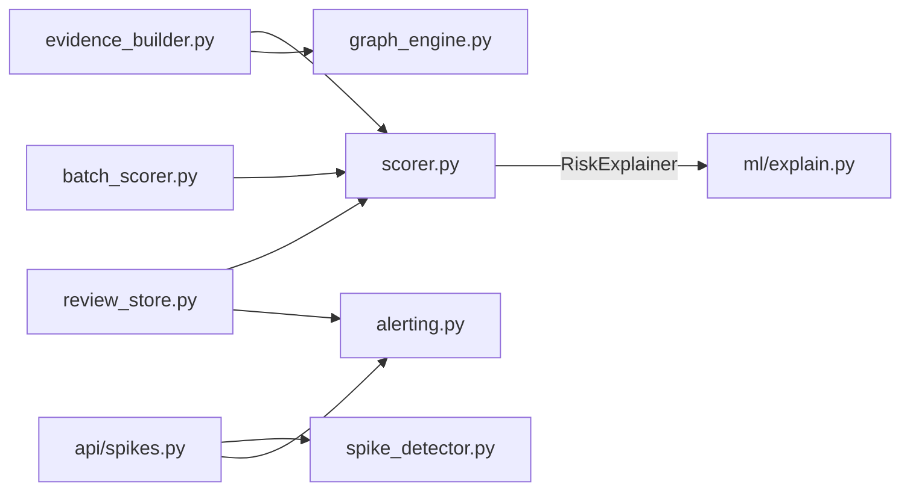

# Vantage Risk — New Developer Onboarding Guide

> This is a knowledge-transfer document, written for someone who has never
> seen this codebase before. It builds on two documents that already exist
> in this repo and are worth reading alongside this one:
> - [`docs/architecture.md`](architecture.md) — the system diagram and the
>   three-layer breakdown (ml/ → backend/ → frontend/), plus three "real
>   bugs worth knowing the reasoning behind."
> - [`docs/metrics_report.md`](metrics_report.md) — the full model
>   evaluation story: honest metrics, cost-weighted thresholds, drift,
>   and why a logistic-regression baseline edges out the production
>   XGBoost model on this dataset.
>
> This guide doesn't repeat what those two already explain well. Instead
> it fills in: the exact request/response flow through real function
> names, the data layer, the API contract end-to-end, how to actually run
> and test everything, and a structured first-week plan.
>
> **Everything below was verified by reading the actual files in this
> repository** (not inferred from the README alone). Where something
> couldn't be verified or is an assumption, it's labeled as such.

---

## 1. The big picture

### What this application does

Vantage Risk is a fraud/risk-management console for e-commerce merchants.
It scores individual orders for two separate risks — **chargeback risk**
(the order will be disputed/charged back) and **return risk** (the item
will be returned) — and wraps that scoring in four operator-facing tools:

| Feature | What it does | Backend route | Frontend page |
|---|---|---|---|
| Order scoring | Score one order through both models, with top contributing factors | `POST /score` | `/app/score` |
| Chargeback evidence | Compile a dispute-response PDF for a specific order | `POST /evidence/{order_id}` + `GET /evidence-files/{order_id}.pdf` | `/app/evidence` |
| Abuse-ring detection | Cluster customers who share a device/address within a tight time window | `GET /graph` | `/app/graph` |
| Fraud-spike monitoring | Weekly chargeback-rate anomaly detection (rolling z-score) | `GET /fraud-spikes` | `/app/spikes` |
| Review queue | Triage medium/high-risk orders, approve/block, audit trail | `GET /review`, `GET /review/resolved`, `POST /review/{order_id}` | `/app/review` |
| Batch scoring | Upload a CSV of orders, score all of them, download annotated results | `POST /score/batch` + `GET /batch-files/{filename}` | `/app/batch` |
| Metrics dashboard | Model health: ROC-AUC, cost-weighted threshold, drift, baseline comparison | `GET /metrics` | `/app` (Dashboard) |

**Primary users** (inferred from the UI copy and README, e.g.
`README.md:9` — "A working risk console for BFSI/e-commerce merchants"):
merchant risk-ops teams and fraud analysts who need to triage flagged
orders, respond to chargebacks with evidence, and monitor fraud trends —
not end consumers.

**This is a demo/personal project, not a production system.** It runs on
**synthetic data** (`backend/ml/generate_synthetic_data.py` generates
20,000 fake orders) and has **no authentication on any endpoint** (stated
plainly in `docs/architecture.md`'s "Where this would need to change for
real production use" section). Treat every number the dashboard shows as
illustrative of the methodology, not a real merchant's actual fraud rate.

> **Provenance note:** this repository was forked from an open-source
> project originally named "Fraud Risk Manager" and rebranded to "Vantage
> Risk" (new name, color theme, fonts) in the session that set up this
> deployment. The git history in this repo starts fresh from that
> rebrand's first commit — there is no inherited commit history from the
> original project.

### Technology stack

| Layer | Technology | Evidence |
|---|---|---|
| Backend framework | FastAPI | `backend/app/main.py:4` |
| Backend server | Uvicorn | `render.yaml:8`, `README.md:73` |
| ML models | XGBoost (`XGBClassifier`) | `backend/ml/train.py:40` |
| Model explainability | SHAP (`TreeExplainer`) | `backend/ml/train.py:130`, `backend/ml/explain.py` |
| Data layer (API contract) | Pydantic | `backend/app/models/schemas.py` |
| Data layer (persistence) | SQLAlchemy ORM + SQLite | `backend/app/db/database.py`, `backend/app/models/db_models.py` |
| Graph clustering | NetworkX | `backend/app/services/graph_engine.py:36` |
| PDF generation | ReportLab | `backend/app/services/evidence_builder.py:14-17` |
| Data manipulation | pandas / numpy | throughout `backend/ml/` and `backend/app/services/` |
| Frontend framework | React 18 + TypeScript | `frontend/package.json:18-19` |
| Frontend build tool | Vite | `frontend/package.json:35` |
| Routing | React Router v6 | `frontend/src/App.tsx:3` |
| Charts | Recharts | `frontend/package.json:22`, `frontend/src/components/charts/` |
| Graph visualization | react-force-graph-2d | `frontend/package.json:20` |
| Styling | CSS custom properties + Tailwind | `frontend/src/styles/tokens.css`, `frontend/tailwind.config.js` |
| Animation | Framer Motion | `frontend/package.json:16` |
| CI | GitHub Actions | `.github/workflows/tests.yml` |
| Backend hosting | Render (always-on web service) | `render.yaml`, `DEPLOYMENT.md` |
| Frontend hosting | Vercel (static) | `frontend/vercel.json`, `DEPLOYMENT.md` |

No external databases beyond SQLite, and no third-party API integrations
except an **optional, generic outbound webhook** (Slack/Discord/ntfy.sh/
anything JSON-accepting) for alerting — see §6.

### Architecture diagram

```mermaid
flowchart TB
    subgraph ML["backend/ml/ — offline training pipeline"]
        GEN[generate_synthetic_data.py] --> SPLIT[train.py:load_and_split<br/>time-based split]
        SPLIT --> TRAIN1[train.py<br/>chargeback XGBoost model]
        SPLIT --> TRAIN2[train_return_model.py<br/>return-risk XGBoost model]
        TRAIN1 --> EVAL[evaluate.py<br/>metrics_report.json]
        TRAIN1 --> BASE[train_baseline_model.py<br/>vs logistic regression]
        TRAIN1 --> ART1[(artifacts/)]
        TRAIN2 --> ART2[(artifacts_returns/)]
    end

    subgraph BACKEND["backend/app/ — FastAPI (Render, always-on)"]
        MAIN[main.py<br/>FastAPI app, CORS, routers]
        API["api/<br/>score · batch · review_queue<br/>metrics · graph · evidence · spikes"]
        SCORER[services/scorer.py<br/>loads both RiskExplainer singletons]
        SERVICES["services/<br/>graph_engine · spike_detector<br/>evidence_builder · review_store<br/>batch_scorer · alerting"]
        DB[(SQLite<br/>review_cases, spike_alerts,<br/>review_alerts)]
    end

    subgraph FRONTEND["frontend/src/ — React console (Vercel, static)"]
        LANDING[Landing.tsx]
        SHELL[AppShell.tsx<br/>sidebar + Outlet]
        PAGES["pages/<br/>Dashboard · ScoreOrder · BatchUpload<br/>ReviewQueue · AbuseGraph · FraudSpikes · Evidence"]
        CLIENT[api/client.ts]
    end

    ART1 --> SCORER
    ART2 --> SCORER
    SCORER --> API
    SERVICES --> API
    MAIN --> API
    API <--> DB
    API <-->|REST / JSON over HTTPS| CLIENT
    CLIENT --> PAGES
    PAGES --> SHELL
    LANDING -->|navigate "/app"| SHELL

    SERVICES -.->|optional HTTP POST| WEBHOOK([Slack / Discord / any<br/>JSON webhook endpoint])
```

---

## 2. Repository structure

```
vantage-risk/
├── backend/
│   ├── app/                     ← FastAPI application (runs at request time)
│   │   ├── main.py              ← entry point: app = FastAPI(...), CORS, routers
│   │   ├── config.py            ← all paths/constants, .env loading, sys.path hack for ml/
│   │   ├── api/                 ← 7 route modules, one per feature
│   │   ├── services/            ← business logic, one file per concern
│   │   ├── models/
│   │   │   ├── schemas.py       ← Pydantic models = the API contract
│   │   │   └── db_models.py     ← SQLAlchemy ORM models = the DB contract
│   │   └── db/
│   │       ├── database.py      ← engine/session setup
│   │       ├── init_db.py       ← create_all() on startup
│   │       └── risk_manager.db  ← the actual SQLite file (legacy name — see §9)
│   ├── ml/                      ← offline training pipeline (NOT run at request time)
│   │   ├── generate_synthetic_data.py
│   │   ├── train.py             ← chargeback model
│   │   ├── train_return_model.py← return-risk model (separate)
│   │   ├── train_baseline_model.py ← XGBoost vs logistic regression
│   │   ├── evaluate.py          ← produces reports/metrics_report.json
│   │   ├── explain.py           ← RiskExplainer class (shared by backend + evaluate.py)
│   │   ├── artifacts/           ← chargeback model.pkl, shap_explainer.pkl, feature_columns.json
│   │   ├── artifacts_returns/   ← same, for the return model
│   │   ├── data/                ← raw/, train.csv, test_holdout.csv
│   │   ├── reports/             ← metrics_report.json, baseline_comparison.json, threshold_sweep.csv
│   │   └── tests/                ← 49 tests (verified count — see §8)
│   ├── tests/                   ← 54 tests against the live API (verified count — see §8)
│   ├── outputs/                 ← generated evidence PDFs + batch result CSVs (gitignored? — see §9)
│   ├── requirements.txt         ← backend + ML runtime dependencies
│   ├── requirements-dev.txt     ← pytest, httpx
│   ├── pytest.ini               ← testpaths = tests
│   └── .env.example             ← ALLOWED_ORIGINS, ALERT_WEBHOOK_URL
├── frontend/
│   ├── src/
│   │   ├── main.tsx             ← ReactDOM.createRoot(...).render(<App/>)
│   │   ├── App.tsx              ← BrowserRouter + route table
│   │   ├── api/
│   │   │   ├── client.ts        ← fetch wrappers, resolveApiUrl, ApiError
│   │   │   └── types.ts         ← TypeScript mirror of backend/app/models/schemas.py
│   │   ├── pages/                ← one file per route (Landing, Dashboard, ScoreOrder, …)
│   │   ├── components/
│   │   │   ├── layout/           ← AppShell (sidebar), PageHeader, ErrorBoundary
│   │   │   ├── risk/              ← ScoreCard, ThresholdSlider, PolicySimulator, FeatureExplanation
│   │   │   ├── charts/            ← ROCCurveChart, ConfusionMatrix, CostCurveChart, DriftChart, SpikeChart
│   │   │   ├── graph/             ← ForceGraph (wraps react-force-graph-2d)
│   │   │   └── ui/                ← shared primitives (atoms.tsx: Panel, ErrorState, etc.) + landing-page effects
│   │   ├── lib/utils.ts          ← cn, formatINR, bandFromScore, timeAgo, etc.
│   │   └── styles/
│   │       ├── tokens.css        ← CSS custom properties — single source of truth for theme
│   │       └── globals.css       ← imports tokens.css, base resets
│   ├── index.html                ← Vite entry HTML, <title>, favicon link
│   ├── package.json              ← scripts: dev, build, typecheck
│   ├── tailwind.config.js        ← maps Tailwind color/font names onto the CSS vars in tokens.css
│   ├── tsconfig.json             ← strict mode on, @/* path alias → src/*
│   └── vercel.json                ← SPA rewrite rule for Vercel
├── docs/
│   ├── architecture.md           ← system diagrams + "why" decisions
│   ├── metrics_report.md         ← full model evaluation writeup
│   └── ONBOARDING.md             ← this file
├── .github/workflows/tests.yml   ← CI: backend+ML pytest, frontend typecheck+build
├── render.yaml                   ← Render Blueprint for the backend
├── DEPLOYMENT.md                 ← step-by-step Render + Vercel deploy guide (current and accurate)
├── README.md
└── sample input/                 ← sample_batch_scoring.csv for manually testing /score/batch
```

**Entry points:**
- Backend: `backend/app/main.py` (the module `uvicorn app.main:app` imports)
- Frontend: `frontend/src/main.tsx` (Vite's configured entry via `index.html`'s `<script type="module" src="/src/main.tsx">`)

**Don't bother studying deeply:** the `ui/` visual-effects components
(`sparkles.tsx`, `wavy-background.tsx`, `canvas-reveal-effect.tsx`,
`card-spotlight.tsx`, `circular-progress.tsx`) — these are landing-page
decoration (particles, WebGL spotlight, wavy backgrounds) with no
business logic. Useful to know they exist; not worth reading line by
line on day one.

---

## 3. Startup and execution flow

### Backend startup (`backend/app/main.py`)

1. `uvicorn app.main:app` imports the module, which runs top-to-bottom:
   - Imports all 7 router modules (`app/api/*.py`) — each one's import
     triggers nothing heavy; routes are just registered, not executed.
   - Builds the `FastAPI(title="Vantage Risk API", ...)` instance.
   - Registers `@app.on_event("startup")` → `init_db()` (creates SQLite
     tables if they don't exist — `backend/app/db/init_db.py:14`).
   - Configures `CORSMiddleware` with dev origins (`localhost:5173`/`5174`)
     plus whatever `ALLOWED_ORIGINS` env var is set (`main.py:27-28`).
   - Calls `app.include_router(...)` seven times, one per feature.
2. On the actual **first request**, model loading happens lazily: the
   first call into `app/services/scorer.py`'s `get_explainer()` or
   `get_return_explainer()` constructs a `RiskExplainer` (from
   `backend/ml/explain.py`), which loads `model.pkl`, `shap_explainer.pkl`,
   and `feature_columns.json` from disk via `joblib.load`. These are
   module-level singletons (`_explainer`, `_return_explainer` globals in
   `scorer.py:24-25`) — loaded once per process, reused for every
   subsequent request. This is why `docs/architecture.md` says Render
   (always-on) suits this app better than a serverless platform: a cold
   serverless invocation would reload both models on every call.

### Frontend startup (`frontend/src/main.tsx` → `App.tsx`)

1. `main.tsx` mounts `<App/>` wrapped in `<ErrorBoundary>` into `#root`.
2. `App.tsx` wraps everything in `<BrowserRouter>`, then renders
   `<AppContent>`, which declares the route table:
   - `/` → `Landing` (marketing page)
   - `/app` → `AppShell` (sidebar layout), with 7 nested index/child routes
     for the actual console pages
   - `*` → `NotFound`
3. Each page component (`pages/*.tsx`) is responsible for its own data
   fetching — there's no global state manager (no Redux/Zustand/Context
   for server data). Every page calls `api.<method>()` from
   `src/api/client.ts` inside a `useEffect` or an event handler, manages
   its own `status: "idle" | "loading" | "error"` state, and renders a
   real error UI on failure (no mock-data fallback — confirmed by reading
   `ScoreOrder.tsx`'s `submit()` function, which sets `status: "error"`
   and shows `<ErrorState>` on a thrown `ApiError`).

### Three representative end-to-end flows

#### Flow 1 — Scoring a single order (`POST /score`)

```
Browser (ScoreOrder.tsx:53 submit())
  → api.scoreOrder(order)                         [frontend/src/api/client.ts:58-62]
  → fetch(`${BASE_URL}/score`, POST, JSON body)
  → FastAPI router: score() in backend/app/api/score.py:11
  → score_order(order) in backend/app/services/scorer.py:85
      1. get_explainer() / get_return_explainer()  — lazy singletons (scorer.py:29-44)
      2. order_features = order.model_dump(exclude={"order_id"})
      3. explainer.explain_order(order_features, top_n=3)
         → RiskExplainer.explain_order() in backend/ml/explain.py:73
           a. _vectorize(): build a single-row DataFrame matching training
              column layout (one-hot encode item_category/payment_method)
           b. self.model.predict_proba(X)[0, 1]  → raw risk_score
           c. self.explainer.shap_values(X)      → per-feature SHAP contributions
           d. filter to positive, non-zero contributions, sort, take top_n
      4. Same call repeated against the SEPARATE return-risk explainer
      5. band_from_score() / return_band_from_score() map each raw score
         to "low"/"medium"/"high" — chargeback uses fixed thresholds
         (0.25/0.6, from app/config.py), return-risk uses thresholds
         loaded from artifacts_returns/train_holdout_meta.json (because
         the two models have different base rates — see scorer.py:47-61)
      6. Returns a ScoreResult (Pydantic model) with both risk profiles
  → FastAPI serializes ScoreResult to JSON
  → Browser: ScoreOrder.tsx renders <ScoreCard result={result} threshold={threshold}/>
```

#### Flow 2 — Generating chargeback evidence (`POST /evidence/{order_id}` then `GET /evidence-files/{order_id}.pdf`)

```
Browser: Evidence.tsx → api.generateEvidence(orderId)
  → POST /evidence/{order_id}
  → create_evidence_packet() in backend/app/api/evidence.py:13
  → generate_evidence(order_id) in backend/app/services/evidence_builder.py:198
      1. _load_orders() — pd.concat(train.csv, test_holdout.csv), cached
      2. look up the row matching order_id; 404 if not found
      3. _build_sections(row) assembles 6 sections, two of which call
         OTHER services rather than duplicating their logic:
           - "Risk assessment": re-runs score_order() on this exact order
             (evidence_builder.py:57) — the SAME production scoring path,
             not a special evidence-only shortcut
           - "Network check": calls find_customer_ring() from
             graph_engine.py (evidence_builder.py:70) — searches the FULL
             uncapped ring set, not just the 60 shown in the graph UI
      4. _render_pdf() builds an actual PDF via ReportLab's
         SimpleDocTemplate, writes it to EVIDENCE_PDF_DIR, returns a
         relative pdf_url ("/evidence-files/{order_id}.pdf")
      5. Returns an EvidencePacket (sections + pdf_url)
  → Browser renders the sections, with a download link/button
Browser: clicking download → GET /evidence-files/{order_id}.pdf
  → download_evidence_pdf() in backend/app/api/evidence.py:30
  → FileResponse(..., filename=...) — sets Content-Disposition: attachment
    explicitly (NOT a generic StaticFiles mount — see the comment in
    evidence.py:31-40 explaining why that distinction matters for
    cross-origin downloads specifically)
```

#### Flow 3 — Batch CSV upload (`POST /score/batch`)

```
Browser: BatchUpload.tsx → api.scoreBatch(file)   [uses FormData, not JSON —
                                                     client.ts:85-100]
  → POST /score/batch (multipart/form-data)
  → score_batch_upload() in backend/app/api/batch.py:15
      - rejects non-.csv filenames with a 400 before even reading the file
  → score_batch(file_bytes, filename) in backend/app/services/batch_scorer.py:51
      1. pd.read_csv() the uploaded bytes; reject empty / missing-column /
         >5000-row files with a ValueError → surfaced as HTTP 400
      2. for each row: build an OrderInput (coercing CSV string/number
         values to real bools via _coerce_bool()), call score_order()
         (the SAME function Flow 1 uses — no separate "batch scoring
         logic")
      3. malformed individual rows are caught (ValidationError/ValueError/
         TypeError/KeyError) and recorded with an error message — the
         WHOLE upload doesn't fail over one bad row
      4. writes an annotated CSV to BATCH_RESULTS_DIR with a uuid-suffixed
         filename, returns a BatchScoreSummary with counts + first 100
         rows inline + a csv_url for the full file
  → Browser shows the summary; "Download full results" hits
    GET /batch-files/{filename} → download_batch_results() in
    backend/app/api/batch.py:45, which also guards against path traversal
    via _safe_filename() before touching the filesystem
```

---

## 4. Major modules / subsystems

### 4.1 `backend/app/api/` — the HTTP layer

**Responsibility:** parse/validate HTTP input, call exactly one service
function, map service-layer exceptions to HTTP status codes, return a
Pydantic response model. **No business logic lives here** — every route
handler is a thin wrapper (confirmed by reading all 7 files; the longest
handler, `score_batch_upload`, is ~15 lines and all of them are
validation/error-mapping, not scoring logic).

| File | Route(s) | Calls into |
|---|---|---|
| `score.py` | `POST /score` | `services/scorer.py` |
| `batch.py` | `POST /score/batch`, `GET /batch-files/{filename}` | `services/batch_scorer.py` |
| `review_queue.py` | `GET /review`, `GET /review/resolved`, `POST /review/{order_id}` | `services/review_store.py` |
| `metrics.py` | `GET /metrics` | reads JSON report files directly (no separate service module) |
| `graph.py` | `GET /graph` | `services/graph_engine.py` |
| `evidence.py` | `POST /evidence/{order_id}`, `GET /evidence-files/{order_id}.pdf` | `services/evidence_builder.py` |
| `spikes.py` | `GET /fraud-spikes` | `services/spike_detector.py`, `services/alerting.py` |

**Error handling pattern, consistent across all 7 files:** domain-specific
exceptions (e.g. a missing order, a malformed CSV) are caught and
re-raised as `HTTPException` with an appropriate status code (400 for
client-caused, 404 for not-found, 500 for unexpected internal failure,
503 for a missing report file). Every generic `except Exception` is
marked `# noqa: BLE001` with a comment explaining it's deliberately broad
— "surface a clean 500 instead of a raw traceback" (`score.py:22`).

### 4.2 `backend/app/services/` — business logic

One file per concern, each independently importable and testable without
spinning up FastAPI. Dependency graph between services (verified by
reading imports):



Two composition patterns worth internalizing (also covered in
`docs/architecture.md`, repeated here because they're the single most
important "how this actually fits together" fact):
- **`evidence_builder.py` doesn't duplicate scoring or ring-detection
  logic** — it calls `scorer.score_order()` and `graph_engine.find_customer_ring()`
  directly, so an evidence packet always reflects the same signals as
  the rest of the app.
- **`graph_engine.py` serves two different callers from one cached
  computation** (`_get_qualifying_components()`): `build_graph()` caps
  the result at 60 rings for the visualization payload; `find_customer_ring()`
  searches the full, uncapped set for the evidence packet's network
  check.

### 4.3 `backend/ml/` — offline training pipeline

**Nothing in this directory runs at request time.** It's a set of
standalone scripts (no `__init__.py` — `app/config.py:53-57` explicitly
adds `ml/` to `sys.path` so the backend can import `explain.RiskExplainer`
without `ml/` being a proper installable package) that produce artifacts
the backend loads from disk.

| Script | Produces | Key function(s) |
|---|---|---|
| `generate_synthetic_data.py` | `data/raw/orders.csv` | `generate()` |
| `train.py` | `artifacts/`, `data/train.csv`, `data/test_holdout.csv` | `load_and_split()`, `build_features()`, `align_columns()` |
| `train_return_model.py` | `artifacts_returns/` | mirrors `train.py`, drops `chargeback` as an additional leakage column |
| `evaluate.py` | `reports/metrics_report.json`, `reports/threshold_sweep.csv` | `metrics_at_threshold()`, `cost_curve()`, `drift_analysis()` |
| `train_baseline_model.py` | `reports/baseline_comparison.json` | reuses `train.py`'s `build_features`/`align_columns` directly |
| `explain.py` | not run standalone; imported by both `backend/app/services/scorer.py` and usable from `evaluate.py`/notebooks | `RiskExplainer` class |

**Why two separately-trained models, not one reused as a proxy:** see
`docs/metrics_report.md` §7 for the full story, including a documented
bug (`return_model`'s first version scored 0.554 AUC — barely above
random — because the synthetic label was almost entirely driven by one
leaked term) and how it was fixed by rebalancing the data-generation
formula, not by retraining until a number looked good.

**Leakage guards** (same pattern in both `train.py` and
`train_return_model.py`): `DROP_COLS` always excludes raw identifiers
(`order_id`, `customer_id`, `device_id`, `shipping_address_hash`), the
ground-truth label used only for synthetic-data generation
(`is_ring_order_GT`), and the OTHER model's target column (`returned`
excluded from the chargeback model; `chargeback` excluded from the
return model) — because neither label is knowable at order-scoring time
in a real deployment.

### 4.4 `backend/app/models/` — the two separate contracts

- **`schemas.py`** (Pydantic) — the **API contract**. Explicitly
  documented at the top of the file: "Field names and shapes deliberately
  mirror `frontend/src/api/types.ts` exactly — if you change a field
  here, update the matching TS interface too." **There is no shared
  code-generation step between these two files** — they're hand-kept in
  sync. This is the single most important thing to know before changing
  any response shape.
- **`db_models.py`** (SQLAlchemy ORM) — the **storage contract**.
  Deliberately kept separate from `schemas.py` per the file's own
  docstring: "the DB row shape and the API response shape are allowed to
  diverge... conflating them tends to leak storage details into the API
  contract." Three tables: `ReviewCaseRow`, `SpikeAlertRow`, `ReviewAlertRow`.

### 4.5 `frontend/src/` — the React console

See §7 for the full breakdown. Key point for this section: there is
**no global client-side state manager**. Every page fetches its own data
via `src/api/client.ts` and owns its own loading/error state locally.
Shared state across the whole app is limited to CSS custom properties
(the theme) and React Router's own route state.

---

## 5. The data layer

### 5.1 Two kinds of "data" in this system

1. **ML training data** — CSV files under `backend/ml/data/` (`train.csv`,
   `test_holdout.csv`) and `data/raw/orders.csv`. These are read directly
   by pandas at request time by several services (`graph_engine.py`,
   `spike_detector.py`, `evidence_builder.py`, `review_store.py`'s
   seeding) — **there is no database table for orders themselves.** The
   "order database," for every feature except the review queue, IS the
   CSV files on disk.
2. **Operational state** — the SQLite database at
   `backend/app/db/risk_manager.db`, which holds only three things: the
   review queue's pending/resolved cases, and dedup records for the two
   alert types. This is genuinely transactional state (created by user
   actions — resolving a case), not training data.

### 5.2 Data models (Pydantic, `schemas.py`)

The full input schema for scoring an order is `OrderInput` (`schemas.py:20-33`):
`account_age_days`, `is_new_account`, `order_value`, `item_category`,
`payment_method`, `discount_pct`, `shipping_billing_mismatch`,
`ip_country_mismatch`, `device_reuse_signal`, `num_previous_orders`,
`num_previous_returns`, `num_previous_chargebacks` (plus optional
`order_id`). Every scoring entry point (`/score`, `/score/batch`, and the
evidence builder's internal re-scoring) constructs exactly this shape.

### 5.3 How data enters, is validated, and flows through

- **Single-order scoring:** JSON body → FastAPI validates against
  `OrderInput` automatically (wrong type/missing field → FastAPI's own
  422 response, before the handler even runs) → `scorer.score_order()`.
- **Batch CSV:** raw bytes → `pandas.read_csv` → per-row manual
  validation/coercion in `batch_scorer.py` (`_coerce_bool()` normalizes
  CSV string values like `"yes"`/`"1"`/`"true"` into real Python bools,
  since CSV has no native boolean type) → `OrderInput(...)` constructed
  manually per row, wrapped in a try/except so one bad row doesn't abort
  the batch.
- **Review queue seeding:** real holdout rows (`test_holdout.csv`) are
  sampled, scored through the real model, and only medium/high-band
  results become `ReviewCaseRow`s — see `review_store.py:_seed_if_empty()`.
  This seeding runs **exactly once**, gated by "does the table already
  have any row" (`review_store.py:56-59`), so restarting the server never
  wipes decisions a user already made.

### 5.4 Relationships and transformations

There's no foreign-key relationship between `ReviewCaseRow`,
`SpikeAlertRow`, and `ReviewAlertRow` — they're independent tables keyed
by `order_id` or `period_start`, joined only in application code (e.g.
`review_store._get_alerted_order_ids()` does one query to cross-reference
which `ReviewCaseRow`s have a matching `ReviewAlertRow`, explicitly
avoiding an N+1 query pattern — see the docstring at `review_store.py:47-51`).

### 5.5 Caching

Several services use **in-process memoization**, not a cache layer like
Redis:
- `metrics.py` uses `@lru_cache(maxsize=1)` on the JSON-report loaders
  (`metrics.py:15`, `32`, `54`) — the report only changes when someone
  re-runs `evaluate.py` offline, so it's loaded once per process and the
  server must be **restarted** to pick up a freshly regenerated report.
- `graph_engine.py` and `spike_detector.py` use module-level `_cache`
  globals populated on first call (`graph_engine.py:42-43`,
  `spike_detector.py:38`) — same effect, different mechanism (no
  decorator, just a global checked at the top of the function).
- `scorer.py`'s loaded models are the same pattern — lazy singleton
  globals, loaded once, reused for the process lifetime.

**Implication:** if you change `train.py` and re-run it to produce new
model artifacts, or re-run `evaluate.py` for a new metrics report, **you
must restart the backend process** for the change to take effect. None
of these caches have a TTL or invalidation hook.

### 5.6 Transactions and consistency

SQLAlchemy sessions are short-lived — opened and closed within a single
service function call (`with SessionLocal() as db: ...`), never held
across an `await` point. `review_store.resolve()` does a straightforward
read-modify-commit-refresh sequence (`review_store.py:157-167`) with no
explicit optimistic-locking or retry logic — fine for SQLite's
single-writer model at this scale, but worth knowing if this ever moves
to a multi-replica deployment (see §9 for the stated limitation).

---

## 6. APIs and integrations

### 6.1 Internal API surface (all routes, verified against the router files)

| Method | Path | Purpose |
|---|---|---|
| GET | `/` | Health check — `{"status": "ok", "service": "vantage-risk-api"}` |
| POST | `/score` | Score one order |
| POST | `/score/batch` | Score a CSV of orders |
| GET | `/batch-files/{filename}` | Download annotated batch-result CSV |
| GET | `/review` | Pending review queue |
| GET | `/review/resolved` | Resolved cases (audit trail) |
| POST | `/review/{order_id}` | Approve/block a pending case |
| GET | `/metrics` | Model evaluation report + return-model summary + baseline comparison |
| GET | `/graph` | Abuse-ring network data |
| POST | `/evidence/{order_id}` | Generate a chargeback evidence packet |
| GET | `/evidence-files/{order_id}.pdf` | Download the generated PDF |
| GET | `/fraud-spikes` | Weekly chargeback-rate anomaly report |
| GET | `/docs` | FastAPI's auto-generated Swagger UI (free, built into FastAPI — not custom code) |

**No authentication on any of these.** Confirmed absent by reading every
router file — no `Depends()` auth dependency, no API key check, no
session cookie handling anywhere in `app/api/`. This is explicitly called
out as a known limitation in `docs/architecture.md`.

### 6.2 External integrations

The **only** external integration is an **optional outbound webhook**
(`backend/app/services/alerting.py`), configured via the `ALERT_WEBHOOK_URL`
environment variable. It's a plain `urllib.request` POST (no SDK, no
extra dependency — `alerting.py:41-60`), deliberately generic so it works
with Slack Incoming Webhooks, Discord, ntfy.sh, or any JSON-accepting
endpoint. Two triggers:
- A newly-detected fraud spike (`maybe_send_spike_alert`, called from
  `GET /fraud-spikes`)
- A newly-seeded high-risk review case (`maybe_send_review_alert`, called
  during `review_store._seed_if_empty()`)

Both are **deduplicated via the database** (`SpikeAlertRow`/`ReviewAlertRow`),
not in-memory — necessary because the frontend calls these GET endpoints
on every page load, and without DB-backed dedup the same spike or case
would re-trigger a notification on every single refresh. A failed
webhook POST (network error, timeout, bad URL) is swallowed and returns
`None` rather than raising — "a notification failing to send shouldn't
take down the endpoint that triggered it" (`alerting.py:46-47`).

**No secrets are present in the repository.** `backend/.env.example`
documents the two env vars (`ALLOWED_ORIGINS`, `ALERT_WEBHOOK_URL`) with
blank/empty example values — this is a template to copy to `.env`, not a
file containing real credentials.

### 6.3 A real import-time gotcha worth knowing (documented in `docs/architecture.md`, repeated here because it bit this codebase before)

`ALERT_WEBHOOK_URL` must always be accessed via `import app.config as config`
then `config.ALERT_WEBHOOK_URL` — **never** `from app.config import ALERT_WEBHOOK_URL`.
The latter captures the value at import time; if a module is imported
before a real `.env` value is loaded, it silently keeps a stale empty
string forever, even after the real value becomes available. Confirmed
in the actual code: both `backend/app/services/alerting.py:22` and
`backend/app/api/spikes.py:4` use `import app.config as config`, not a
`from`-import.

---

## 7. Frontend and backend, in detail

### 7.1 Frontend

**Page structure:** `/` is `Landing.tsx` (marketing page with particle
effects, a "secure access" transition animation, and feature cards). All
console functionality lives under `/app/*`, rendered inside `AppShell.tsx`
(a sidebar + `<Outlet/>` layout) — `Dashboard` (index), `ScoreOrder`,
`BatchUpload`, `ReviewQueue`, `AbuseGraph`, `FraudSpikes`, `Evidence`.

**State management:** none global. Every page is a self-contained
function component with local `useState` for its data, loading state, and
errors. There's no React Context, Redux, Zustand, or React Query —
confirmed by the absence of any such import across every page file
checked.

**Data fetching pattern** (consistent across pages): call an `api.*`
method from `client.ts` inside `useEffect` (for data that loads on page
mount) or inside an event handler (for user-triggered actions like
`ScoreOrder`'s submit button), track `status: "idle" | "loading" | "error"`,
and render `<ErrorState message={...} onRetry={...}/>` on failure. No
page silently shows stale or fake data when the backend is unreachable.

**Backend communication** (`frontend/src/api/client.ts`):
- `BASE_URL` comes from `VITE_API_BASE_URL` (baked in at Vite **build**
  time, not read at runtime — this is why `DEPLOYMENT.md` repeatedly
  warns that changing this env var on Vercel requires a new deploy, not
  just a save), falling back to `http://localhost:8000` for local dev.
- `resolveApiUrl()` exists specifically because the backend returns
  **relative** paths (e.g. `/evidence-files/ORD-1.pdf`) that must be
  resolved against the API's origin, not the page's own origin —
  otherwise a download link would silently point at the Vite dev server
  instead of the FastAPI backend.
- `ApiError` is a typed exception carrying the HTTP status, thrown on any
  non-2xx response, so every page's catch block can distinguish failure
  reasons if needed.

**Routing-and-animation interaction worth knowing before touching
`Landing.tsx` or `App.tsx`:** the "secure access" transition overlay that
plays when entering the console lives in `App.tsx` as a **sibling** of
`<Routes>`, not nested inside `Landing`. This is deliberate and
documented in a comment at `App.tsx:16-26` — if the overlay lived inside
`Landing`, React Router would unmount it the instant `navigate("/app")`
fires (because `Landing` itself unmounts), cutting its fade-out animation
short. This was a real bug caught on a live deploy, per `docs/architecture.md`.

**Design system / theming:** `frontend/src/styles/tokens.css` defines all
colors, fonts, radii, and shadows as CSS custom properties under `:root`.
`tailwind.config.js` maps Tailwind's color/font utility names onto the
same variables, so inline styles and Tailwind classes never visually
drift apart. As of this session's rebrand: accent color is violet
(`#8b5cf6`), fonts are Space Grotesk (display), Inter (body), JetBrains
Mono (numeric/code values) — chargeback/return/abuse-ring signal colors
(red/amber/green) are intentionally kept separate from the accent color
and were **not** changed, since they're semantic risk indicators, not
brand decoration.

### 7.2 Backend

**Services, not controllers:** FastAPI route handlers (`app/api/*.py`)
are intentionally thin — see §4.1. All actual logic lives in
`app/services/*.py`, each independently unit-testable without an HTTP
layer (confirmed by `backend/tests/` importing and exercising these
through `TestClient`, and `backend/ml/tests/` exercising the ML functions
directly with no FastAPI involvement at all).

**Middleware:** only `CORSMiddleware` is configured (`main.py:30-36`).
There's no custom request-logging middleware, no rate limiting, no auth
middleware.

**Background processing:** there is none. Batch scoring, evidence PDF
generation, and all route handlers are fully synchronous within the
request/response cycle — confirmed by the absence of any task
queue (Celery, RQ, FastAPI `BackgroundTasks`) anywhere in the codebase.
This is explicitly flagged as a scaling limitation in `docs/architecture.md`:
"Batch scoring is synchronous and capped at 5,000 rows... a real version
would want a background job queue for larger files."

---

## 8. Working with the project

### 8.1 Local setup (verified against actual repo files)

**Backend:**
```bash
cd backend
pip install -r requirements.txt
cp .env.example .env   # optional — add ALERT_WEBHOOK_URL to enable real alerting
uvicorn app.main:app --reload   # http://localhost:8000 ; Swagger UI at /docs
```
⚠️ This assumes `backend/ml/artifacts/` and `backend/ml/artifacts_returns/`
already exist (they're committed to this repo). If they didn't, you'd
need to run the training pipeline first (see below) before the backend
would start successfully — `scorer.py`'s singletons will raise on first
request if `model.pkl` is missing.

**Training pipeline (only needed if you change the data/model code):**
```bash
cd backend/ml
python generate_synthetic_data.py --n_orders 20000 --seed 42
python train.py
python evaluate.py
python train_return_model.py
python train_baseline_model.py
```

**Frontend:**
```bash
cd frontend
npm install
npm run dev   # Vite dev server — port depends on availability (5173 by default)
```
⚠️ There is **no `frontend/.env.example`** in this repo, despite the root
`README.md`'s quickstart (`README.md:78`) saying `cp .env.example .env`
for the frontend — this instruction is **unverifiable/stale**. In
practice, `VITE_API_BASE_URL` just needs to be set in a `frontend/.env`
file you create yourself, or it falls back to `http://localhost:8000`
automatically (`client.ts:17`).

### 8.2 Running tests

```bash
# ML pipeline tests (49 tests, verified by counting test_*.py functions)
cd backend/ml && pytest -v

# Backend API tests (54 tests, verified by counting test_*.py functions)
cd backend && pytest -v
```
Both suites run automatically on every push/PR via
`.github/workflows/tests.yml`. The backend test suite uses a disposable
SQLite database (`backend/tests/conftest.py` sets `TEST_DB_PATH` to a
fresh temp file **before** any `app.*` module is imported — this ordering
matters because `app.config.DB_PATH` is read once at import time), so
running tests never touches your real dev database.

**Frontend:** no dedicated test runner is configured (no Vitest/Jest/
Playwright in `package.json`). The closest thing to a frontend test is:
```bash
cd frontend
npm run typecheck   # tsc --noEmit
npm run build       # tsc -b && vite build — also type-checks
```
This is a stated, acknowledged gap — `docs/architecture.md`: "No
automated tests on the frontend... every page was verified by hand."

### 8.3 Linters

No linter config (ESLint/Ruff/Flake8/Black) was found in either
`backend/` or `frontend/` at the time of this writing. TypeScript's
`strict: true` compiler mode (`frontend/tsconfig.json:9`) is the only
automated code-quality gate on the frontend; there is none on the
backend beyond the test suite itself.

### 8.4 Debugging common problems

| Symptom | Likely cause | Where to look |
|---|---|---|
| `/score` returns 500 | Model artifacts missing or malformed | `backend/ml/artifacts/` and `artifacts_returns/` exist? Re-run `train.py` |
| `/metrics` returns 503 | `evaluate.py` hasn't been run | `backend/ml/reports/metrics_report.json` missing |
| Frontend shows CORS error in console | Frontend origin not in backend's allowlist | `ALLOWED_ORIGINS` env var on the backend, or `main.py:27` dev origins |
| A generated PDF/CSV opens inline instead of downloading | Would only happen if someone re-introduces a generic `StaticFiles` mount | Both download routes already use explicit `FileResponse(..., filename=...)` — see `evidence.py:30-52`, `batch.py:44-57` |
| Review queue "resets" after a Render redeploy | Render free-tier disk isn't guaranteed persistent | Expected behavior, documented in `DEPLOYMENT.md`'s "Known limitations" section |
| A webhook alert never fires even with `ALERT_WEBHOOK_URL` set | Either genuinely no spike/high-risk case yet, OR already alerted for that exact period/order (dedup) | Check `SpikeAlertRow`/`ReviewAlertRow` table contents |
| Changed `evaluate.py`'s cost assumptions but the API's risk bands didn't change | `app/config.py`'s `FALSE_POSITIVE_COST_INR`/`BAND_HIGH_THRESHOLD`/etc. are a **separate, duplicated** copy | Update both `backend/ml/evaluate.py` and `backend/app/config.py` — see the file's own docstring at `config.py:5-10` |

### 8.5 Deployment

Fully documented in `DEPLOYMENT.md` at the repo root — it's accurate and
current (verified against the actual live deployment set up this
session: backend on Render at `vantage-risk-cfvv.onrender.com`, frontend
on Vercel at `vantage-risk-delta.vercel.app`). Two points worth
remembering:
- `VITE_API_BASE_URL` is a **build-time** env var on Vercel — changing it
  requires a new deploy, not just a dashboard save.
- Render's free tier cold-starts after ~15 minutes idle (30-60s delay on
  the next request) and its disk isn't guaranteed to persist across
  redeploys (SQLite review-queue state and generated files can reset).

---

## 9. Important technical considerations

### Architectural patterns

- **Thin controllers, fat services** — see §4.1/§4.2. Consistent across
  all 7 feature areas.
- **Singleton model loading** — both ML models are loaded once per
  process and reused (`scorer.py`). Correct for a single-process
  deployment; would need rethinking (shared cache, or per-worker reload)
  under multiple backend replicas.
- **Separate Pydantic (API) and SQLAlchemy (storage) models** — a
  deliberate choice, documented in `db_models.py`'s own module docstring.
- **Two independently-trained models, never one reused as a proxy for
  the other** — the chargeback and return-risk models each have their
  own leakage guards, their own risk-band thresholds, and are explicitly
  verified (via `ml/tests/test_return_model.py`) to actually disagree on
  real orders, proving they're not redundant.

### Naming conventions worth knowing

- Database tables use `*Row` suffix for ORM classes (`ReviewCaseRow`,
  `SpikeAlertRow`, `ReviewAlertRow`) vs. plain names for Pydantic schemas
  (`ReviewCase`).
- Service functions that build a response for a route are typically named
  after the route's purpose, not the HTTP verb (`build_graph`,
  `build_spike_report`, `score_order`, `generate_evidence`) — grep for
  these names, not for route paths, when tracing logic.

### Confirmed issues / stated limitations (from the code's own comments and `docs/architecture.md`, not inferred)

- **No authentication** on any endpoint.
- **SQLite is single-instance** — would need Postgres before running
  multiple backend replicas behind a load balancer.
- **Batch scoring is synchronous**, capped at 5,000 rows — no background
  job queue.
- **No automated frontend tests** — every page verified by hand
  (`tsc`/build + manual click-through), not Vitest/Playwright.
- **Synthetic training data** — no real BFSI transaction data was used;
  metrics should be re-validated against real data before any production
  use (`docs/metrics_report.md` §9).
- **`backend/ml/evaluate.py`'s cost assumptions (`FP_COST`/`FN_COST`) are
  manually duplicated** in `backend/app/config.py`
  (`FALSE_POSITIVE_COST_INR`/`FALSE_NEGATIVE_COST_INR`) — the file's own
  docstring warns that changing one without the other causes the API's
  risk bands and the offline metrics report to silently disagree.

### Potential concerns I noticed (inferred, not stated in the repo — flagged as such)

- **The SQLite file is still named `risk_manager.db`** (`backend/app/config.py:44`,
  `backend/app/db/risk_manager.db`) even though the project itself was
  rebranded to "Vantage Risk" this session. This is cosmetic only (it's
  an internal filename, never exposed via any API response) but worth
  knowing so it isn't mistaken for a bug or leftover reference to a
  different system.
- **`frontend/README.md`'s quickstart references a `frontend/.env.example`
  file that does not exist** in this repo — a new developer following
  that instruction literally will get a "file not found" on the `cp`
  command. Not a code bug, just a stale doc instruction (see §8.1).
- **`backend/outputs/`** (evidence PDFs, batch result CSVs) is generated
  at runtime and was found committed in the repo's initial commit (at
  least a few sample files were present) — worth checking whether this
  directory should be in `.gitignore` going forward, since these files
  regenerate on demand and committing them risks the repo accumulating
  stale generated artifacts over time. **I did not verify this is
  currently causing a problem** — just flagging it as worth a look.
- **No rate limiting anywhere** — combined with "no authentication,"
  anyone with the URL can call `/score` or `/score/batch` as many times
  as they want. Fine for a personal/demo deployment; would matter before
  sharing the URL broadly.

---

## 10. Knowledge-transfer summary

### Concise project overview

Vantage Risk is a two-model (chargeback risk + return risk) fraud/return
console for e-commerce merchants: a FastAPI backend serving XGBoost
models with SHAP explanations, SQLite for a small amount of operational
state (review queue, alert dedup), and a React/Vite frontend with no
global state manager — every page fetches its own data directly. Deployed
as backend (Render) + frontend (Vercel), connected via CORS + a
build-time env var. Runs entirely on synthetic data; built to demonstrate
honest ML evaluation practice (time-based splits, cost-weighted
thresholds, drift detection, an honest baseline comparison) as much as to
demonstrate the fraud-ops features themselves.

### Component-by-component summary

| Component | One-line summary |
|---|---|
| `backend/ml/` | Offline scripts that generate synthetic data and train/evaluate two independent XGBoost models |
| `backend/app/api/` | Thin FastAPI route handlers, one file per feature, zero business logic |
| `backend/app/services/` | All business logic — scoring, graph clustering, spike detection, evidence generation, alerting, review-queue persistence |
| `backend/app/models/` | Two parallel contracts: Pydantic (API) and SQLAlchemy (storage), deliberately not unified |
| `backend/app/db/` | Minimal SQLite setup — 3 tables, no migrations framework (schema created via `create_all()`) |
| `frontend/src/pages/` | 8 route-level components (1 landing + 7 console pages), each self-contained |
| `frontend/src/api/` | The only place that knows the backend's HTTP contract |
| `frontend/src/components/` | Reusable UI split by domain (`risk/`, `charts/`, `graph/`) and by role (`layout/`, `ui/`) |

### Glossary

| Term | Meaning in this codebase |
|---|---|
| **Chargeback** | A payment dispute where the customer's bank reverses the charge — the primary fraud signal this app scores for |
| **Return risk** | The separate risk that an order will be returned (not necessarily fraudulent) — modeled independently of chargeback risk |
| **Risk band** | `low` / `medium` / `high` — the discretized output of a raw 0-1 risk score, via fixed or empirical thresholds |
| **Abuse ring** | A cluster of customers linked by a shared device or shipping address within a short time window — a signal of coordinated fraud, not individual risk |
| **Drift** | Degradation in model precision/recall over time as fraud tactics evolve — measured by slicing the holdout set chronologically |
| **Cost-weighted threshold** | The decision threshold that minimizes total expected ₹ cost (FP cost × count + FN cost × count), not the one that maximizes accuracy/F1 |
| **Leakage** | A feature or label that wouldn't actually be available at prediction time in production, but which can't be reused as a training signal without invalidating the evaluation |
| **SHAP** | SHapley Additive exPlanations — the method used to attribute a model's prediction to individual input features, powering the "top contributing factors" shown on every score |
| **Holdout set** | The strictly-later-in-time portion of the dataset the model never saw during training — used for all reported metrics |
| **Review queue** | The operational list of medium/high-risk orders awaiting a human approve/block decision |

### 10-15 files to study first (with why)

1. **`docs/architecture.md`** — read this before anything else; it has
   the system diagram and the three most important "why" decisions.
2. **`backend/app/main.py`** — the entire app's wiring in ~55 lines.
3. **`backend/app/api/score.py`** + **`backend/app/services/scorer.py`**
   — the core scoring flow, the simplest complete request path to trace.
4. **`backend/ml/explain.py`** — the `RiskExplainer` class every score
   ultimately runs through; small, self-contained, directly testable.
5. **`backend/app/models/schemas.py`** — the entire API contract in one
   file; read this before changing any response shape.
6. **`backend/app/config.py`** — every path and constant the backend
   depends on; explains the `ml/` sys.path trick and the duplicated cost
   constants.
7. **`backend/app/services/evidence_builder.py`** — the best example of
   services composing other services rather than duplicating logic.
8. **`backend/app/services/graph_engine.py`** — the most algorithmically
   interesting service, with a documented real bug (the "28,000-node
   blob") and its fix.
9. **`backend/ml/train.py`** — shows the time-based split and leakage
   guards that everything else in the ML story depends on.
10. **`docs/metrics_report.md`** — the full honesty-first evaluation
    story; essential context for why the model behaves the way it does.
11. **`frontend/src/App.tsx`** — the entire route table, plus the one
    documented React Router/animation gotcha.
12. **`frontend/src/api/client.ts`** + **`frontend/src/api/types.ts`** —
    the frontend's entire understanding of the backend, in two files.
13. **`frontend/src/pages/ScoreOrder.tsx`** — the clearest example of this
    codebase's data-fetching + error-handling pattern, to copy for any
    new page.
14. **`backend/tests/conftest.py`** — explains the test-isolation trick
    (env var set before import) that's easy to break if you're not
    careful editing test setup.
15. **`DEPLOYMENT.md`** — not code, but required reading before touching
    anything related to CORS, env vars, or the deploy pipeline.

### Suggested first-week plan

- **Day 1:** Read `docs/architecture.md`, this document, and
  `docs/metrics_report.md`. Get the backend and frontend running locally
  (§8.1). Click through every page in the console against your local
  backend.
- **Day 2:** Trace Flow 1 (single-order scoring) end-to-end by setting a
  breakpoint (or just reading, top to bottom) through `ScoreOrder.tsx` →
  `client.ts` → `api/score.py` → `scorer.py` → `ml/explain.py`. Run
  `backend/ml/tests/test_explainer.py` and read what it asserts.
- **Day 3:** Trace Flow 2 (evidence) and Flow 3 (batch), noting the two
  places `evidence_builder.py` calls into other services instead of
  duplicating logic. Run the full backend test suite and read
  `backend/tests/conftest.py` to understand the test-isolation setup.
- **Day 4:** Read all of `backend/app/services/graph_engine.py` and
  `spike_detector.py` carefully — these have the most interesting
  algorithmic decisions and the best "why we didn't do the naive thing"
  comments in the codebase.
- **Day 5:** Read the frontend's `styles/tokens.css` + `tailwind.config.js`
  theming setup, and skim every page component to understand the shared
  data-fetching pattern. Try making one small, safe change (see starter
  tasks below) and open a PR against your own fork.

### Five realistic starter tasks

1. **Add a new human-readable feature label.** `backend/ml/explain.py`'s
   `FEATURE_LABELS` dict maps raw column names to display labels; some
   features (e.g. any new feature you might add later) fall back to a
   generic title-cased name. Pick an existing feature whose fallback
   label reads awkwardly and add a proper entry. Low risk, touches one
   file, immediately visible in the `/app/score` page's top-reasons list.
2. **Add a new `item_category` or `payment_method` option** end-to-end:
   add it to `generate_synthetic_data.py`'s category list, regenerate
   data, retrain, and update `frontend/src/pages/ScoreOrder.tsx`'s
   `CATEGORIES`/`PAYMENT_METHODS` arrays. Good exercise for touching both
   the ML pipeline and the frontend without changing any API contract.
3. **Write one new backend test** for an edge case you notice isn't
   covered — e.g. what `POST /review/{order_id}` does if called twice on
   the same already-resolved order (currently: it will silently
   re-resolve it with a new timestamp — verify that's actually the
   intended behavior, and either confirm it with a test or flag it).
4. **Add a loading skeleton or improve an existing error message** on one
   console page — a safe, contained frontend-only change that exercises
   the data-fetching pattern described in §7.1 without touching the API.
5. **Document the `GET /review/{order_id}` double-resolve behavior from
   task 3** (or any other behavior you had to read code to understand)
   as a comment in the relevant service file, following this codebase's
   existing convention of explaining *why*, not *what*.

### Questions to ask the existing team (or, absent a team, to resolve yourself before relying on this system further)

1. Is `backend/outputs/` (generated PDFs/CSVs) supposed to be
   `.gitignore`'d? A few sample files appear to be committed — confirm
   whether that was intentional.
2. Should `backend/app/db/risk_manager.db`'s filename be updated to match
   the "Vantage Risk" branding, or is renaming it low-value churn not
   worth the (small) risk of breaking a path reference?
3. Is there a plan to add authentication before this is shared more
   broadly than a personal demo? What would the minimum viable approach
   be (API key header? OAuth?) given the current all-synchronous,
   single-process architecture?
4. Should `frontend/README.md`'s quickstart be corrected to stop
   referencing a non-existent `.env.example`?
5. Is the plan to eventually retrain on real transaction data, and if so,
   what would need to change in `train.py`/`train_return_model.py` beyond
   swapping the data source (e.g. are the current categorical feature
   values — `item_category`, `payment_method` — exhaustive of what a
   real merchant's data would contain)?

---

**Accuracy note:** every file path, function name, and line reference in
this document was read directly from the repository at the time of
writing, not inferred from documentation or assumed from naming
conventions. Where a claim could not be verified this way (e.g. whether
`backend/outputs/` is meant to be gitignored), it's explicitly marked as
inferred or unverified rather than stated as fact.
